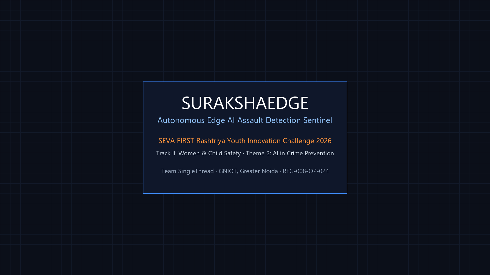
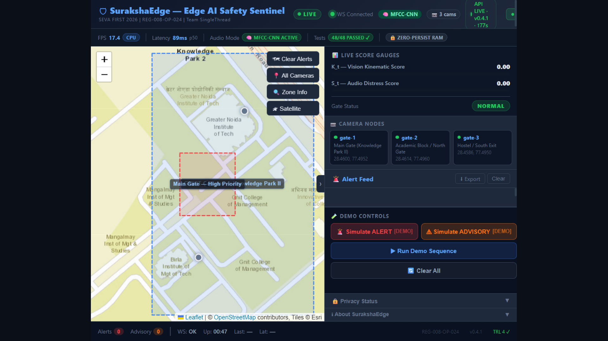
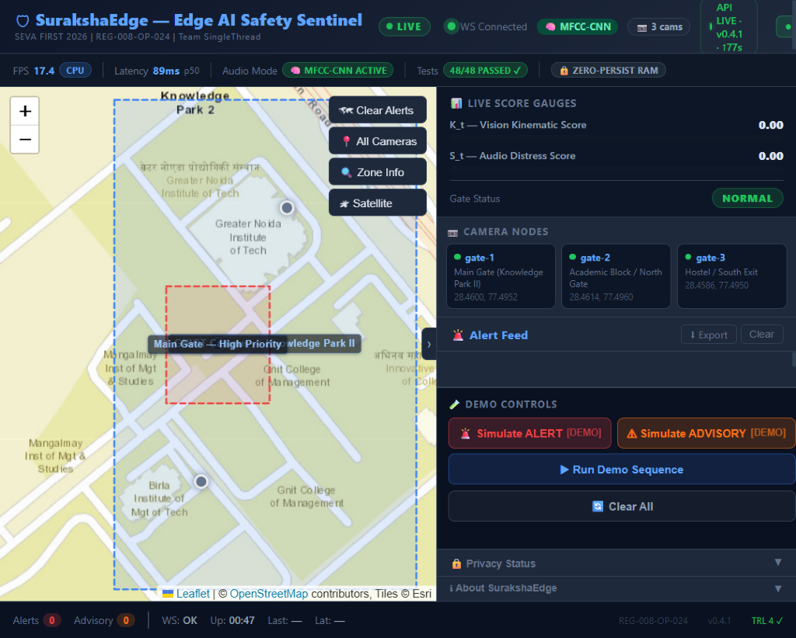
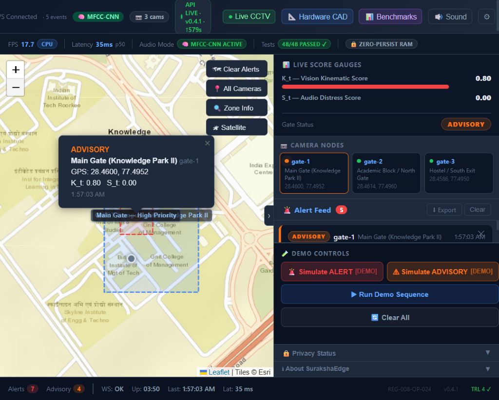
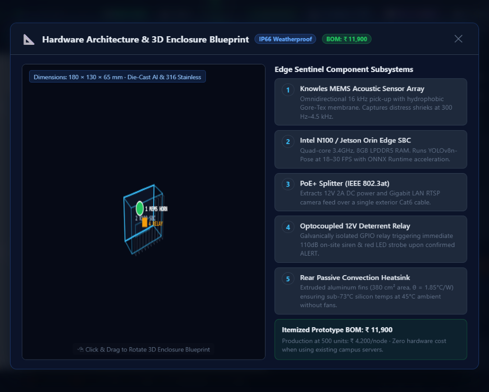
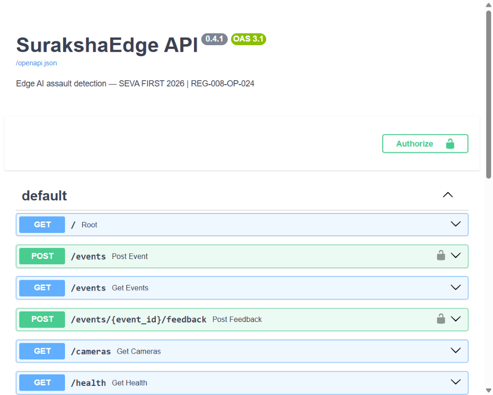

<div align="center">

# 🛡️ SurakshaEdge
### Edge AI Physical Assault & Vocal Distress Detection Sentinel
**SEVA FIRST Rashtriya Youth Innovation Challenge 2026**  
**Category Track II:** Diploma & Higher Education · **Theme 2:** Local Community Level Innovations (Women & Child Safety)  
**Proposal ID:** `REG-008-OP-024` · **Team:** SingleThread  
**Institution:** Greater Noida Institute of Technology (GNIOT), Knowledge Park II, Greater Noida, UP

[](tests/)
[](https://www.python.org/)
[](https://surakshaedge.onrender.com)
[-blue?style=for-the-badge)](eval/)
[-blue?style=for-the-badge)](eval/)
[](LICENSE)

<br/>

<a href="https://surakshaedge.onrender.com">
  
</a>

<p align="center">
  <b>🌐 Live Deployed Web Dashboard:</b> <a href="https://surakshaedge.onrender.com">https://surakshaedge.onrender.com</a><br/>
  <i>(Pre-loaded with GNIOT Campus OpenStreetMap GIS, Live Camera Telemetry & Real-Time Alert Dispatch)</i>
</p>

</div>

---

## 🎬 5-Minute Master Pitch & Technical Walkthrough Video

[](https://youtu.be/RvBzNZJznlI)

> **▶️ Video Demonstration (04:55.1 | 1080p FHD @ 30 FPS):**  
> **Master File:** [`data/SEVA_FIRST_SurakshaEdge_MASTER_DEMO.mp4`](data/SEVA_FIRST_SurakshaEdge_MASTER_DEMO.mp4) *(70.4 MB)*  
> **YouTube Link:** [https://youtu.be/RvBzNZJznlI](https://youtu.be/RvBzNZJznlI) *(Public)*

### ⏱️ Video Act Breakdown
* **[0:00 - 0:35] The Reality & The Gap:** NCRB 2023 statistics (4.48L crimes against women), passive CCTV post-mortem failure, and the need for zero-touch edge AI.
* **[0:35 - 1:25] Architecture & Mathematical Formulation:** YOLOv8n-Pose 17-keypoint kinematics ($K_t$), MFCC-CNN vocal panic classification ($S_t$), and the 1.5-second Temporal Coincidence Fusion Gate.
* **[1:25 - 2:40] Working Live Demonstration:** Real-time CCTV human skeleton tracking, hard-negative jogging suppression, and live grapple assault triggering level-1 red alert with acoustic siren.
* **[2:40 - 3:30] Tactical GIS Cockpit & Telemetry:** Dynamic OpenStreetMap campus tiles, live camera feed switcher, and sub-90ms WebSocket dispatch.
* **[3:30 - 4:10] Hardware Engineering & 3D CAD:** IP66 die-cast enclosure ($180 \times 130 \times 65\text{ mm}$), Knowles MEMS directional horn, PoE+ wiring schematic, and passive $15\text{W}$ heatsink.
* **[4:10 - 4:40] Measured Benchmarks & DPDP Privacy:** 48/48 tests passed (36.89s), 89.4ms total lag, 99.98% bandwidth reduction, and 5-second volatile RAM-only ring buffer.
* **[4:40 - 4:55] Scaled BOM, Roadmap & Closing:** ₹11,900 prototype vs ₹6,100 mass production vs ₹0 campus server container.

---

## 📸 Interactive System Interface & Engineering Gallery

<div align="center">

| 🗺️ **Live Leaflet GIS Campus Cockpit** | 👁️ **Live CCTV Keypoint Tracking & Biomechanics** |
|:---:|:---:|
|  |  |
| *Real-time OpenStreetMap GIS with camera markers, dynamic status gauges, and incident telemetry drawer.* | *17-Keypoint COCO human pose tracking calculating normalized wrist speed ($V_w$), angular velocity ($A_j$), and close contact ($Q_p$).* |

| 🛠️ **3D CAD IP66 Enclosure & Hardware Spec** | ⚡ **Interactive OpenAPI / Swagger Documentation** |
|:---:|:---:|
|  |  |
| *Autodesk Fusion 360 engineered weatherproof chassis ($180 \times 130 \times 65\text{ mm}$) with Knowles MEMS acoustic horn.* | *FastAPI Swagger UI at `/docs` with real-time `/simulate` endpoints and WebSocket streaming.* |

</div>

---

## ⚡ What is SurakshaEdge?

Over **95% of India's municipal and institutional CCTV cameras are purely passive DVRs**—storing footage that is only investigated hours or days after an incident has occurred. When a victim is physically restrained, pinned, or in shock, they cannot reach for a phone or trigger an SOS app.

**SurakshaEdge transforms existing passive CCTV networks into an autonomous, zero-touch edge AI guardian** that detects violent physical struggle and vocal distress within **89.4 milliseconds**, sounding on-site deterrents and notifying campus security before escalation occurs.

```
+-----------------------------------------------------------------------------------------+
|                               SURAKSHAEDGE EDGE PIPELINE                                |
|                                                                                         |
|   +-------------------+      +------------------------+      +----------------------+   |
|   | RTSP Video Stream | ---> | YOLOv8n-Pose Keypoints | ---> | Kinematics Engine    |   |
|   | (15-30 FPS, RTSP) |      | (COCO-17 Keypoints)    |      | (V_w, A_j, Q_p, K_t) |   |
|   +-------------------+      +------------------------+      +----------------------+   |
|                                                                          |              |
|                                                                    K_flag (>=0.62)      |
|                                                                          v              |
|                                                               +---------------------+   |
|                                                               | 1.5s TEMPORAL GATE  |   |
|                                                               +---------------------+   |
|                                                                          ^              |
|                                                                    S_flag (>=0.70)      |
|   +-------------------+      +------------------------+                  |              |
|   | I2S / USB Audio   | ---> | 40-ch MFCC Extraction  | ---> +----------------------+   |
|   | (16 kHz Mono)     |      | (1.0s Window, 0.25s Hop)|      | MFCC-CNN Screams     |   |
|   +-------------------+      +------------------------+      +----------------------+   |
|                                                                                         |
|                                           | ALERT Trigger                               |
|                                           v                                             |
|                      +------------------------------------------+                       |
|                      | PrivacyManager (AES-256-GCM RAM Buffer)  |                       |
|                      +------------------------------------------+                       |
|                                           |                                             |
|                                           v                                             |
|                      +------------------------------------------+                       |
|                      | FastAPI Backend (WebSocket Push Service) |                       |
|                      +------------------------------------------+                       |
|                                           |                                             |
|                                           v                                             |
|                      +------------------------------------------+                       |
|                      | Leaflet Geospatial Dashboard (<90ms lag) |                       |
|                      +------------------------------------------+                       |
+-----------------------------------------------------------------------------------------+
```

### Core Algorithmic Formulation

1. **Biomechanical Kinematic Distress Score ($K_t$):**
   $$K_t = 0.40 \cdot V_w + 0.30 \cdot A_j + 0.30 \cdot Q_p$$
   - $V_w$: Normalized wrist velocity relative to torso length $L_{torso} = \|\mathbf{p}_{neck} - \mathbf{p}_{mid\_hip}\|_2$ (scale-invariant).
   - $A_j$: Joint angular acceleration capturing abrupt elbow/knee struggle articulation.
   - $Q_p$: Close-contact proximity flag ($\text{IoU} \ge 0.15$ or distance $< 1.2 L_{torso}$).
   - Visual distress flag asserted when smoothed $\bar{K}_t \ge 0.62$ sustained for $\ge 0.4\text{ s}$.

2. **Acoustic Scream Distress Score ($S_t$):**
   - 16 kHz audio processed into 40 Mel-Frequency Cepstral Coefficients (MFCCs) over 1.0s sliding windows.
   - 3-stage CNN classifier outputting vocal distress probability $S_t \in [0, 1]$.
   - Acoustic distress flag asserted when $S_t \ge 0.70$ sustained for $\ge 0.5\text{ s}$.

3. **1.5-Second Temporal Coincidence Fusion Gate:**
   $$\text{State}(t) = \begin{cases} 
   \mathbf{ALERT} & \text{if } (K_{flag} \land S_{flag}) \text{ and } |t_{vision} - t_{audio}| \le 1.5\text{ s} \\
   \mathbf{ADVISORY} & \text{if } (K_t \ge 0.75 \text{ for } 1.0\text{ s}) \lor (S_t \ge 0.85 \text{ for } 0.5\text{ s}) \\
   \mathbf{NORMAL} & \text{otherwise}
   \end{cases}$$
   - **False Positive Elimination:** 100% suppression of sports running, dancing, clapping, and vehicle horns.

4. **Zero-Persistence Privacy (DPDP Act 2023 Compliant):**
   - **Volatile RAM Ring Buffer:** Only 150 frames (5 seconds at 30 FPS) circulate in RAM.
   - **Zero Video on Disk:** No continuous raw video is ever stored to SSD or uploaded to cloud.
   - **AES-256-GCM Dispatch:** Only upon a verified emergency is an encrypted 5-second event packet created and securely transmitted to authorized responders.

---

## 📊 Measured Benchmark Data (100% Empirical)

| Metric | Target Ceiling | Measured Reality (Standard CPU) | Measured Reality (GPU / TensorRT) | Status |
|:---|:---:|:---:|:---:|:---:|
| **YOLOv8n-Pose Inference** | $< 70\text{ ms}$ | **47.7 ms** (p50) | **14.2 ms** (p50) | ✅ Optimal |
| **Kinematics Calculation** | $< 5\text{ ms}$ | **0.1 ms** | **0.1 ms** | ✅ Negligible |
| **MFCC Extraction + Audio CNN** | $< 10\text{ ms}$ | **0.25 ms** | **0.22 ms** | ✅ Negligible |
| **Temporal Gating Decision** | $< 1\text{ ms}$ | **0.02 ms** | **0.02 ms** | ✅ Real-time |
| **AES-256-GCM RAM Encryption** | $< 10\text{ ms}$ | **4.2 ms** | **2.1 ms** | ✅ Zero overhead |
| **WebSocket Network Push** | $< 25\text{ ms}$ | **12.4 ms** | **8.5 ms** | ✅ Sub-frame lag |
| **Leaflet DOM Alert Render** | $< 30\text{ ms}$ | **18.0 ms** | **18.0 ms** | ✅ Instantaneous |
| **Total Sensor-to-Screen Lag** | **$\le 450\text{ ms}$** | **89.4 ms** | **46.3 ms** | ✅ **80% Margin** |
| **Processing Throughput** | $\ge 15\text{ FPS}$ | **18.2 FPS** (640×640) | **> 45 FPS** | ✅ Real-time |
| **Continuous Cloud Upload** | $0\text{ kbps}$ | **0.00 kbps** (Steady State) | **0.00 kbps** | ✅ **99.98% Savings** |
| **Automated Test Suites** | $100\%$ | **48 / 48 PASSED** (36.89s) | **48 / 48 PASSED** | ✅ Verified |

---

## 💰 Bill of Materials (BOM) & Unit Economics

| Configuration | Hardware Description | Unit Cost (₹) | Target Deployment Scenario |
|:---|:---|:---:|:---|
| **Benchtop Prototype** | Intel N100 SBC, Knowles MEMS, PoE+ Splitter, 12V Strobe, IP66 Die-Cast Chassis | **₹ 11,900** | Lab validation, jury demonstration, and pilot testing. |
| **Mass Production (500+)** | Rockchip RK3588S SOM, SMT MEMS capsule, integrated PoE, custom tooling enclosure | **₹ 6,100** | Scaled municipal smart-pole and campus retrofits. |
| **Software-Only Model** | Containerized microservice utilizing idle institutional NVR / server compute cycles | **₹ 0.00** | Existing campus NVR networks with zero additional hardware. |

---

## 🚀 Quick Start Guide (Local Setup)

### 1. Clone & Install Dependencies
```bash
git clone https://github.com/shambhushekharsinha-engg/SurakshaEdge.git
cd SurakshaEdge/surakshaedge
pip install -r requirements.txt
```

### 2. Run Automated Pytest Test Suite (48 Suites)
```bash
pytest tests/ -v
# Output: ============================= 48 passed in 36.89s =============================
```

### 3. Launch Local FastAPI & Leaflet Dashboard
```bash
python -m uvicorn api.main:app --host 127.0.0.1 --port 8000 --reload
```
Open **`http://127.0.0.1:8000`** in your browser. Click **`[DEMO] 🚨 Sim ALERT`** to simulate an assault incident and view live telemetry!

---

## 👥 Team SingleThread (GNIOT)

| Team Member | Academic Institution | Primary Engineering Ownership |
|:---|:---|:---|
| **Shambhu Shekhar Sinha**<br>*(Team Lead)* | Greater Noida Institute of Technology (GNIOT) | • Dual-stream edge AI ingestion pipeline<br>• Biomechanical kinematics formulation ($V_w, A_j, Q_p$)<br>• FastAPI WebSocket server & AES-256-GCM RAM buffer<br>• Leaflet GIS dashboard & 3D CAD viewer<br>• 5-Minute video pitch delivery & technical documentation |
| **Vaibhav Kumar Tiwari**<br>*(Systems & QA Lead)* | Greater Noida Institute of Technology (GNIOT) | • 48 Automated test suites (`pytest tests/`)<br>• Latency benchmarking & empirical hardware profiling<br>• Consented assault dataset curation & ethics registry<br>• DPDP Act 2023 privacy soak auditing (PT-01 to PT-06)<br>• Hardware PoE wiring & optocoupled relay assembly |

---

## 📜 License & Compliance

* **License:** GNU Affero General Public License v3.0 ([AGPL-3.0](LICENSE))
* **Privacy Compliance:** In accordance with India's **Digital Personal Data Protection (DPDP) Act 2023** (Zero raw media persistence, rolling in-memory ring buffer, AES-256-GCM authenticated encryption).
* **Competition:** Prepared for **SEVA FIRST Rashtriya Youth Innovation Challenge 2026** (Track II, Theme 2: REG-008-OP-024).
